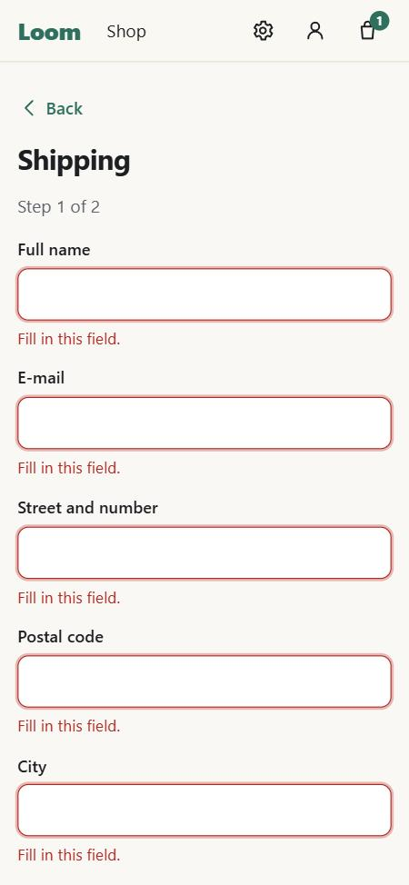
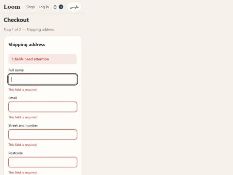

# web-quality-skills

AI-assistant skills for people building web apps and PWAs, with two ways in:

| Command | You give it | You get |
|---|---|---|
| [`/build-web-app`](skills/build-web-app/SKILL.md) | An idea for a site or app | A short brief to approve, then the project built milestone by milestone with UI, accessibility, translation, security, privacy and legal standards in from the first commit |
| [`/audit-web-app`](skills/audit-web-app/SKILL.md) | An existing project | One prioritized checklist — **Must** and **Should**, security first, then privacy & legal, UI/UX bugs and design quality — with locations and fixes; nothing is changed |

Both use three topic skills, which also work on their own:

| Skill | What it does | Runs |
|---|---|---|
| [`native-feel-ui`](skills/native-feel-ui/SKILL.md) | Builds web interfaces that feel like polished native mobile and desktop apps, with full design guidance (principles, foundations, ~40 components, UX patterns, inputs): grouped settings lists, segmented controls, sheets, alerts, tab and navigation bars, forms, toasts, loading states, swipe actions, type scale, motion and sound, light/dark/automatic themes, glass, right-to-left, accessibility. Includes two complete example pages a guide for a "living" landing page, and one for sign-in / sign-up / password reset. | Automatically when you work on UI |
| [`web-ui-pitfalls`](skills/web-ui-pitfalls/SKILL.md) | Audits a front end for bugs that pass review but break for real people: CSS lost in the build, PWA start page and updates, iOS Safari quirks, performance, offline and error states, dropped sessions, back buttons, dark-mode icons, overlays, onboarding, translations, permission prompts, demo modes, merge leftovers. Includes a scanner and a browser test plan. | Automatically on "review / audit my UI", or by name |
| [`launch-security-legal-check`](skills/launch-security-legal-check/SKILL.md) | Pre-launch review of security (secrets incl. git history, vulnerable dependencies, sessions, rate limits, headers, cookies, backups), privacy and legal (GDPR policy, consent, records of processing, processor agreements, breach plan, terms, imprint, e-mail authentication, payments and consumer law, app stores, other regions, accessibility law) and licenses (code, fonts, icons, assets). Includes a scanner. | When you ask for a security / launch / privacy check, or by name |

> The legal checklist is general information, not legal advice. It focuses on
> the EU/GDPR; ask a qualified lawyer for binding answers.

## Does it work?

We built the same small online store twice — once by an agent without
these skills, once with `/build-web-app` — then audited the first one with
`/audit-web-app`.

| | Without skills | With skills | Without, then audited |
|---|---|---|---|
| Checkout flow | ❌ crashed (blank page) | ✅ | ✅ |
| Errors shown at the right field, focus moved there | – | partly | ✅ |
| Theme setting, Undo, legal drafts, delete account | ❌ | ✅ | ✅ |
| Scanner findings (Must) | 5 | 0 | 0 |

| Without skills | With skills | After the audit |
|---|---|---|
|  |  |  |

**Recommended workflow:** build with `/build-web-app`, then run
`/audit-web-app` once. Method, full results, limitations and what changed
in the skills afterwards: [docs/case-study.md](docs/case-study.md).

## Use it

### Claude Code

```
/plugin marketplace add ArianPmd/web-quality-skills
/plugin install web-quality-skills@web-quality-skills
```

Then either describe what you want ("I have an idea for a booking site…",
"check my project for problems") and the matching skill starts on its own,
or call it by name:

```
/build-web-app a booking site for a small yoga studio, German and English
/audit-web-app
```

Or copy a folder from `skills/` into your project's `.claude/skills/` (or
`~/.claude/skills/` for all projects).

### Claude apps and API

Upload a skill folder (zipped) as a custom skill.

### Other assistants (Cursor, GitHub Copilot, Codex, …)

Skills are plain Markdown. Tools that read `AGENTS.md` or support the Agent
Skills format can use this repo directly; otherwise point your assistant at
the right `SKILL.md`, e.g. *"Follow skills/web-ui-pitfalls/SKILL.md and audit
this project."*

### Chat assistants (ChatGPT, Gemini, …)

Paste or attach a `SKILL.md` and its `references/` files and ask it to follow
them. Scripts need to run on your machine (`node <script>`).

## Scanners

```bash
# from your project's root
node path/to/skills/web-ui-pitfalls/scripts/check.mjs dist
node path/to/skills/launch-security-legal-check/scripts/scan.mjs
node path/to/skills/launch-security-legal-check/scripts/scan.mjs --url https://staging.your-domain.com
```

Only scan URLs you own. Results are leads to confirm, not verdicts.

## Contributing

Scanner changes come with a fixture in `tests/fixtures/` — a real problem
that must be reported and a look-alike that must not be — and pass
`node tests/run.mjs`.

Each checklist item should be generic (no project names), say how to detect
it and how to fix it, and carry a level: `[M]` Must or `[S]` Should.

A pre-commit hook (`scripts/privacy-guard.mjs`, enabled with
`git config core.hooksPath .githooks`) blocks e-mail addresses, keys and the
words listed in your local, git-ignored `.private-words` file.

## License

MIT
