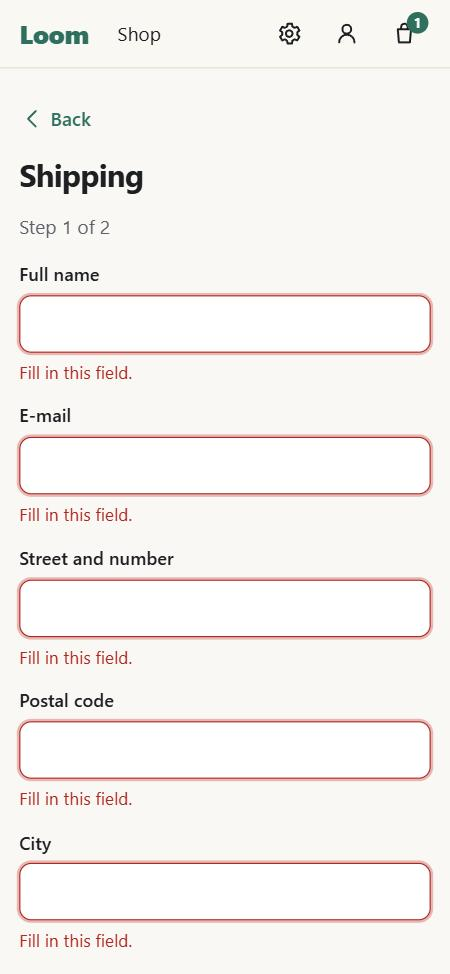
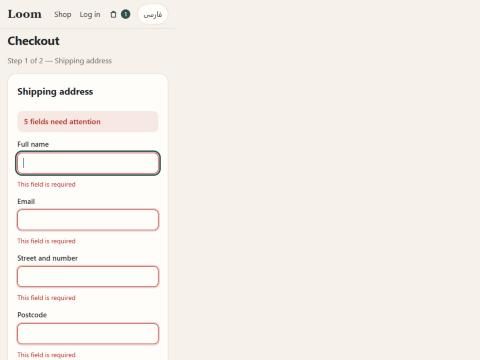
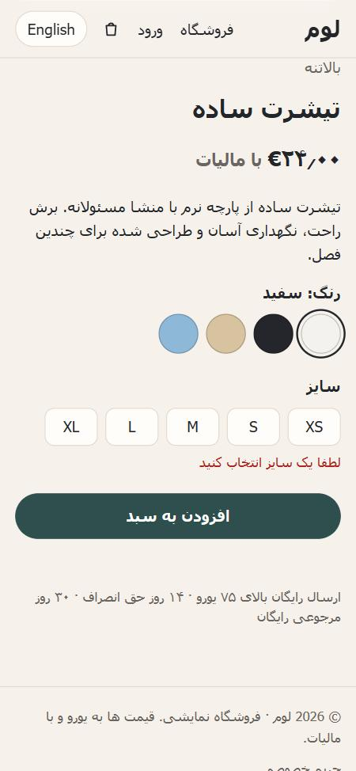
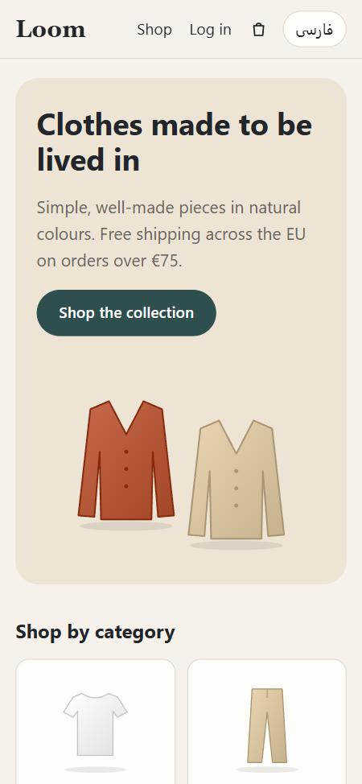
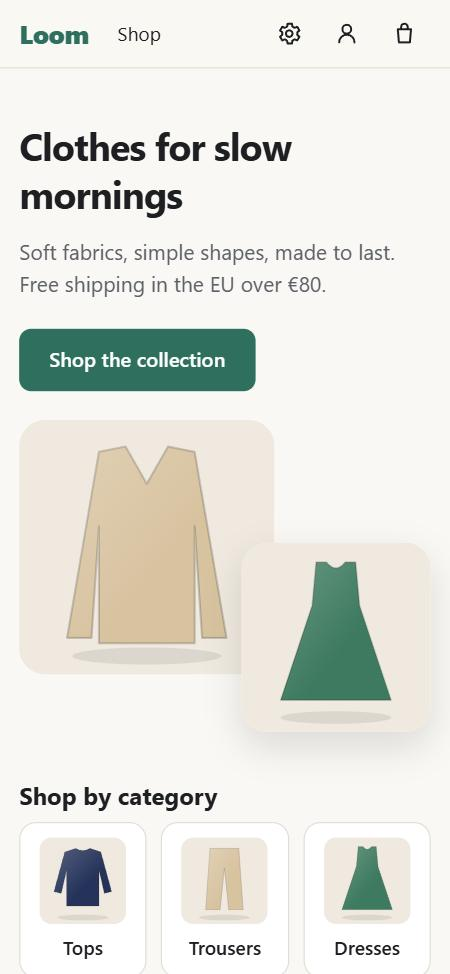
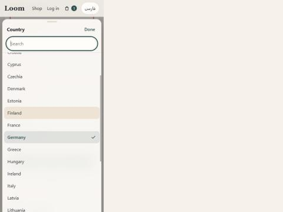

# Case study: the same store, built with and without these skills

**Question:** does an AI coding agent build a better web app with these
skills than without them — and can the audit skill fix an app that was
built without them?

**Short answer:** the store built without the skills looked fine and passed
its build, but **you couldn't buy anything** — going to checkout crashed the
page. The store built with the skills worked end to end. The best result
came from auditing the first store with the skills afterwards: every
finding fixed, including things the skill-built store had missed.

## Method

- **One brief, two agents.** Both got the same request: a small online
  clothing store — React + TypeScript + Vite, frontend only, data in
  localStorage, mock payment; home, catalog with filters and sorting,
  product page, bag, checkout, sign-up/log-in; ~20 products with images
  drawn in code; English and Persian (right-to-left); customers in the EU.
- **Without skills:** a fresh agent, told not to read or use the skills.
- **With skills:** a fresh agent using `/build-web-app` (and the skills it
  points to). Its intake questions were answered up front.
- **Then:** both apps were installed, built and opened in a browser at
  phone width (375 px), light and dark, English and Persian; both skill
  scanners were run on both.
- **Then:** a copy of the without-skills store was audited with
  `/audit-web-app` and fixed, with the design skill as the main guide.
- Every claim below was checked in the running app, not taken from the
  agents' reports.

## Results

| | Without skills | With skills | Without skills, then audited |
|---|---|---|---|
| Build + typecheck | ✅ | ✅ | ✅ |
| **Bag → Checkout** | ❌ **blank page** | ✅ | ✅ |
| Tested in a browser by the agent | no | yes (phone only) | yes |
| Empty checkout form | – (crash) | red outline + message per field; focus **didn't** move | red outline + message per field, summary, focus on the first field |
| Sort / country lists | native `<select>` | native `<select>` | option-picker sheet with search |
| Size not chosen | message only | message + red outline | message + red outline + focus |
| Theme setting (Automatic / Light / Dark) | no | yes | yes |
| Remove from bag | instant | with Undo | with Undo |
| Plurals ("1 item") | – | "1 items" | correct, locale digits |
| Terms / Imprint pages | no | drafts | drafts |
| Delete account | no | yes | yes |
| CSP / known vulnerable dependencies | no / 2 moderate | yes / 0 | yes / 0 |
| UI scanner (Must / Should) | 5 / 3 | 0 / 0 | 0 / 0 |
| Agent time | 6 min | 9 min | ~10 min (audit + fixes) |

### The crash

```tsx
useEffect(() => window.scrollTo(0, 0), [pathname]);
```

It looks harmless. In current browsers the scroll APIs return a Promise;
React treats the effect's return value as its cleanup function and throws
*"destroy is not a function"* on the next navigation — the whole app
unmounts and the page goes blank. A build and a typecheck can't see it;
clicking through the checkout flow does.

| Without skills | With skills | After the audit |
|---|---|---|
|  |  |  |

### Right-to-left, error on a missing size

| Without skills | With skills |
|---|---|
|  |  |

### Home page and the option picker after the audit

| Without skills | With skills | Country picker after the audit |
|---|---|---|
|  |  |  |

## What we learned — and fed back into the skills

1. **Clicking through the main flow matters more than anything else.** The
   skills already required a browser check; they now also require an
   end-to-end click-through at phone *and* desktop width, an automated
   smoke test of the main flow that fails on console errors, and proving
   every claim in the page (e.g. reading `document.activeElement` rather
   than trusting that the code calls `focus()`).
2. **The audit is as valuable as the build.** It found what the
   skill-built store missed. Recommended workflow: build with
   `/build-web-app`, then run `/audit-web-app` once.
3. **Scanner precision.** The effect check now rates a call by what it
   returns (scroll APIs, timers, fetch, async = Must; project functions
   that return nothing = no warning), which removed four false alarms on
   this project while keeping the real crash.
4. **New rules** from this run: an error boundary in every app (no blank
   pages), a custom 404 page, the option picker instead of every native
   `<select>`, plurals through `Intl.PluralRules`, messages stored as keys
   (so they re-translate), and CSP in the production response.

## Limitations

- **One run per side.** Agents vary between runs; small differences may be
  chance. The large ones (a crash, missing pages) are less likely to be.
- **One kind of app** (a small storefront), one stack (React + Vite).
- **Phone width only** in the side-by-side screenshots; desktop
  screenshots couldn't be captured in the test environment.
- The audit was given the issues already found by the comparison as a
  starting point, plus its own findings.
- The test stores are throwaway demos (mock payment, local accounts) and
  are not part of this repository. The store name "Loom" seen in the
  screenshots was picked by the agents; it is a fictional shop and is not
  affiliated with any company or product of that name.
